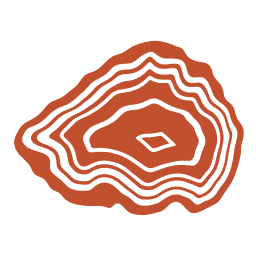
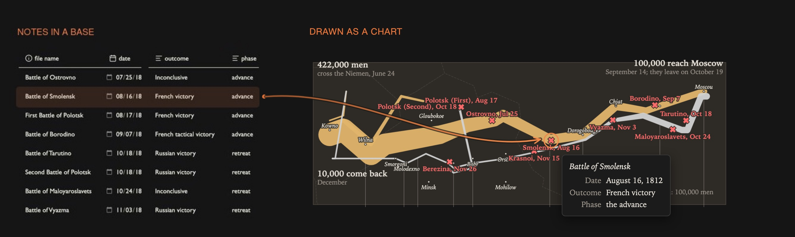

# Agate

Charts that grow out of your notes. Agate is an Obsidian plugin that draws [Vega](https://vega.github.io/vega/) and [Vega-Lite](https://vega.github.io/vega-lite/) charts from [Bases](https://help.obsidian.md/bases): a base picks the notes, their properties become the data, and the chart follows as you add notes, change a value or filter the view.



**[Website](https://casyfill.github.io/Agate/) · [Quickstart](https://casyfill.github.io/Agate/quickstart.html) · [Gallery](https://casyfill.github.io/Agate/gallery.html) · [Guide](docs/guide.md) · [Changelog](CHANGELOG.md)**

## What it does

- **A chart is a Bases view.** Add an **Agate chart** view to any base. It appears wherever a base does: its own tab, embedded in a note (`![[Books.base#Ratings]]`), the sidebar, Canvas. The Bases toolbar's filter, sort and grouping drive the chart.
- **Or a chart in a note**, with an ```` ```agate ```` code block: a spec file, rows from a base, or a self-contained spec.
- **Full Vega and Vega-Lite**, so no option list to outgrow: maps and globes, networks of linked notes, folder sunbursts, timelines, sankeys, linked dashboards.
- **More than a plain spec gets:** each note's own CSV or URL as data, the links between notes and the folder tree as datasets, headline numbers as note text, hatching and dot textures, map tiles under a route (with API keys kept in Obsidian's secret storage), click a mark to open its note.
- **Looks like your vault:** the `obsidian` theme follows your Obsidian theme and light/dark mode; Vega's stock themes and your own theme files are there too.

## Install

In Obsidian: Settings → Community plugins → Browse, search for **Agate**, install and enable it. Needs Obsidian 1.13 or later with the core Bases plugin on. Before the listing is live, or to try a pre-release, install it with [BRAT](https://github.com/TfTHacker/obsidian42-brat) (add `Casyfill/Agate`), or copy `main.js`, `manifest.json` and `styles.css` from the [latest release](https://github.com/Casyfill/Agate/releases) into `.obsidian/plugins/agate/`.

Then follow the [quickstart](https://casyfill.github.io/Agate/quickstart.html): 26 book notes to a bookshelf chart in about fifteen minutes. The [guide](docs/guide.md) covers everything else.

## Network use

Agate makes no network requests by default. Everything it draws comes from your vault.

- **Load remote data** (off by default) lets a spec load data files and images from `http(s)` URLs: remote CSV or JSON, map tiles under a route, pictures in image marks. Agate fetches only the URLs written in your specs, from whichever service they name; it sends no other data and has no telemetry.
- **API keys** (Advanced settings) are kept in Obsidian's secret storage and sent only to the one host you allow for each key.
- Images inside tooltips are an exception: vega-tooltip shows them as ordinary `` elements, so a spec that puts an image URL in a tooltip loads it on hover even with Load remote data off.

## Making charts

- **Pick a recipe:** an empty Agate view offers thirteen ready-made charts. Agate asks which property goes where and writes the spec.
- **Ask an assistant:** **Copy prompt for an LLM** copies your base's properties, sample rows and Agate's rules for any chat assistant.
- **With an AI agent that works on your vault** (Claude Code and others): give it the [`agate-chart` skill](skills/agate-chart/SKILL.md). It knows Agate's conventions and extras and checks a spec renders before handing it over. Copy the `skills/agate-chart` folder into your agent's skills folder, for example `~/.claude/skills/`.
- **By hand:** specs are plain JSON. Install the [JSON Editor](https://community.obsidian.md/plugins/json-editor) community plugin to edit them inside Obsidian; **Edit spec** on a chart opens its spec beside it, and every save redraws the chart.

## Works with

- [Vega Visualizations](https://github.com/Justin-J-K/obsidian-vega) (```` ```vega ```` / ```` ```vega-lite ```` blocks): both plugins can be on. Without it, a setting lets Agate handle those blocks too.
- Other plugins can extend Agate through `app.plugins.plugins.agate.api` (data schemes, expression functions, themes, spec preprocessors); see [ADR 0001, D7](docs/adr/0001-architecture-and-roadmap.md).

Known limits are in the [guide's troubleshooting section](docs/guide.md) and [why-agate.md](docs/why-agate.md).

## Development

Node 22.12+ (`.nvmrc`), Obsidian 1.13+.

```sh
npm install
make demo            # regenerate the demo vault, build, link the plugin into it
npm run dev          # rebuild main.js on change
make check           # typecheck, lint, tests (what CI runs)
```

Open `demo-vault/` in Obsidian: the gallery's notes plus test notes under `tests/` (start with `tests/Test guide.md`). `make help` lists every target. Architecture and decisions: [`docs/adr/`](docs/adr/); testing: [`docs/testing.md`](docs/testing.md); backlog: [`docs/future-features.md`](docs/future-features.md); releasing: [`docs/releasing.md`](docs/releasing.md) (`make release VERSION=x.y.z`).

## License

MIT. Vega, Vega-Lite and vega-embed are bundled under their own BSD-3-Clause licenses.
