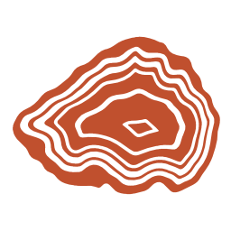
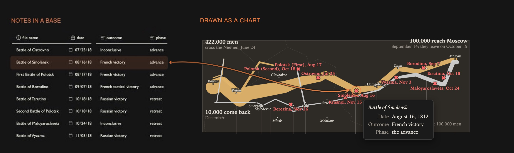

# Agate

Agate brings [Vega](https://vega.github.io/vega/) and [Vega-Lite](https://vega.github.io/vega-lite/) visualizations to Obsidian. Create charts from Bases views that follow your notes, filters, and groups, or define your own visualizations in an agate code block.

Start with a ready-made chart, then customize it as needed—from simple comparisons to maps, timelines, networks, and dashboards.



**[Website](https://casyfill.github.io/Agate/) · [Quickstart](https://casyfill.github.io/Agate/quickstart.html) · [Gallery](https://casyfill.github.io/Agate/gallery.html) · [Guide](docs/guide.md) · [Changelog](CHANGELOG.md)**

## What would you chart?

If your notes have properties, you already have the data. A few ideas, from sensible to slightly obsessive:

- **Learning.** One note per practice problem, with a score before and after reading up. See which topics are getting better and which you keep avoiding.
- **Board games.** Which games on the shelf actually get played, how long a "quick game" really takes, and who keeps winning.
- **Reading.** Pages per month, ratings by genre, and the books you started in March and never finished.
- **Work and side projects.** Which meetings eat your Tuesdays, and how many side projects are "in progress" (all of them).
- **Recipes.** Cooking time against how often you actually make a dish, and the cuisine you keep saving but never cook.
- **D&D campaigns.** Sessions, NPCs and factions as linked notes: who knows whom, who betrayed whom, and the party's route across the map.
- **Travel.** Give place notes coordinates and link them from trip notes, and your trips become routes on a globe you can spin ([gallery](https://casyfill.github.io/Agate/gallery.html)).
- **History.** Battle notes with dates, places and outcomes, drawn as Minard's map of Napoleon's 1812 campaign. That's the picture above.
- **Habits and mood.** A daily note with a few numbers adds up to a year of streaks and slumps.
- **The vault itself.** How your notes link to each other, and which folders take up the most space.

## What it does

- **Chart as a Bases view.** Add an **Agate chart** view to any base. It appears wherever a base does: its own tab, embedded in a note (`![[Books.base#Ratings]]`), the sidebar, Canvas. The Bases toolbar's filter, sort and grouping drive the chart.
- **Charts in a note**, with an ```` ```agate ```` code block (or ```` ```vega ````, once enabled in settings): a spec file, rows from a base, or a self-contained spec.
- **Full support for Vega and Vega-Lite specs**, so no option list to outgrow: maps and globes, networks of linked notes, folder sunbursts, timelines, sankeys, linked dashboards.
- **Extras on top of plain Vega:**
  - **Per-note data.** A note can point to its own CSV, JSON or URL, e.g. a time series for each stock or city note ([guide](docs/guide.md#6-per-note-external-data)).
  - **Your vault as data.** Links between notes and the folder tree are datasets, so you can draw link graphs, arc diagrams, sunbursts and treemaps that follow the base's filter ([guide](docs/guide.md#10-gallery-structure-maps-flows)).
  - **Click to open.** Clicking a point, bar or node opens its note.
  - **Big numbers.** Live totals and averages shown as note text instead of a chart ([guide](docs/guide.md#11-experimental-big-numbers-as-note-text)).
  - **Map tiles under your marks**, with API keys kept in Obsidian's secret storage ([guide](docs/guide.md#basemaps-under-a-route)).
  - **Hatched and dotted fills** for print-style charts ([guide](docs/guide.md#textures-hatching-and-dots-svg-only)).
- **Looks like your vault:** the `auto` theme follows your Obsidian theme and light/dark mode, with chart colors made for popular themes (Minimal's color schemes, Catppuccin, Nord, Gruvbox and more, see [Themes](docs/themes.md)); Vega's stock themes and your own theme files are there too.
- **Built with LLMs in mind.** Write everything by hand, or let an assistant do it: LLMs know Vega-Lite well, so any of them can create a chart or tailor a custom theme for you.

## Install

In Obsidian: Settings → Community plugins → Browse, search for **Agate**, install and enable it. Needs Obsidian 1.13 or later with the core Bases plugin on. Works on desktop and mobile.

Then follow the [quickstart](https://casyfill.github.io/Agate/quickstart.html): 26 book notes to a bookshelf chart in about fifteen minutes. The [guide](docs/guide.md) covers everything else.

## Network use

Agate makes no network requests by default. Everything it draws comes from your vault.

- **Load remote data** (off by default) lets a spec load data files and images from `http(s)` URLs: remote CSV or JSON, map tiles under a route, pictures in image marks. Agate fetches only the URLs written in your specs, from whichever service they name; it sends no other data and has no telemetry.
- **API keys** (Advanced settings) are kept in Obsidian's secret storage and sent only to the one host you allow for each key.
- Images inside tooltips are an exception: vega-tooltip shows them as ordinary `` elements, so a spec that puts an image URL in a tooltip loads it on hover even with Load remote data off.

## Making charts

- **Pick a recipe:** an empty Agate view offers thirteen ready-made charts. Agate asks which property goes where and writes the spec.
- **Ask an assistant:** **Copy prompt for an LLM** copies your base's properties, sample rows and Agate's rules for any chat assistant.
- **With an AI agent that works on your vault** (Claude Code and others): give it the [`agate-chart` skill](skills/agate-chart/SKILL.md). It knows Agate's conventions and extras and checks a spec renders before handing it over. Copy the `skills/agate-chart` folder into your agent's skills folder, for example `~/.claude/skills/`.
- **By hand:** specs are plain JSON. Install the [JSON Editor](https://community.obsidian.md/plugins/json-editor) community plugin to edit them inside Obsidian; **Edit spec** on a chart opens its spec beside it, and every save redraws the chart.

## Works with

- [Vega Visualizations](https://github.com/Justin-J-K/obsidian-vega) (```` ```vega ```` / ```` ```vega-lite ```` blocks): both plugins can be on. Without it, a setting lets Agate handle those blocks too.
- Other plugins can extend Agate through `app.plugins.plugins.agate.api` (data schemes, expression functions, themes, spec preprocessors); see [ADR 0001, D7](docs/adr/0001-architecture-and-roadmap.md).

Known limits are in the [guide's troubleshooting section](docs/guide.md) and [why-agate.md](docs/why-agate.md).

## Development

Node 22.12+ (`.nvmrc`), Obsidian 1.13+.

```sh
npm install
make demo            # regenerate the demo vault, build, link the plugin into it
npm run dev          # rebuild main.js on change
make check           # typecheck, lint, tests (what CI runs)
```

Open `demo-vault/` in Obsidian: the gallery's notes plus test notes under `tests/` (start with `tests/Test guide.md`). `make help` lists every target. Architecture and decisions: [`docs/adr/`](docs/adr/); testing: [`docs/testing.md`](docs/testing.md); backlog: [`docs/future-features.md`](docs/future-features.md); releasing: [`docs/releasing.md`](docs/releasing.md) (`make release VERSION=x.y.z`).

## License

MIT. Vega, Vega-Lite and vega-embed are bundled under their own BSD-3-Clause licenses; see [THIRD_PARTY_NOTICES.md](THIRD_PARTY_NOTICES.md).
