# Agate architecture review

| | |
|---|---|
| Version reviewed | 0.5.0 (`3d54ad2`), updated for the restructuring in [ADR-0003](adr/0003-state-at-0-5.md) |
| Date | 2026-11-08 |
| Scope | `src/` (about 4,950 lines of TypeScript plus 13 recipe specs), `test/`, build and CI |
| Companion docs | [ADR-0001](adr/0001-architecture-and-roadmap.md) (decisions D1 to D13), [ADR-0002](adr/0002-one-vault.md), [ADR-0003](adr/0003-state-at-0-5.md) (amendments from this review), [property-scan.md](property-scan.md), [testing.md](testing.md) |

This document explains how Agate works as built, then reviews it. The ADRs say what was decided and why; this says where each decision lives in the code today and where the code has moved past them. Decision numbers (D3, D12, …) refer to ADR-0001 unless they say ADR-0003, which amends it.

All diagrams are Mermaid, so they render on GitHub and in Obsidian's reading view.

## Contents

1. [The short version](#1-the-short-version)
2. [System context](#2-system-context)
3. [Code map](#3-code-map)
4. [Startup](#4-startup)
5. [Surface A: the Bases view](#5-surface-a-the-bases-view)
6. [Surface B: the code block](#6-surface-b-the-code-block)
7. [The renderer](#7-the-renderer)
8. [Data model](#8-data-model)
9. [Theme and config resolution](#9-theme-and-config-resolution)
10. [Loader and the network boundary](#10-loader-and-the-network-boundary)
11. [What makes a chart redraw](#11-what-makes-a-chart-redraw)
12. [Authoring aids: recipes, prompt, paste, skill](#12-authoring-aids-recipes-prompt-paste-skill)
13. [Extension API](#13-extension-api)
14. [Build, test, release](#14-build-test-release)
15. [Review](#15-review)
16. [File index](#16-file-index)

## 1. The short version

Agate does three things: it turns Bases entries into plain JSON rows, it hands those rows to a Vega or Vega-Lite spec, and it keeps the resulting Vega View in sync with Obsidian (data, theme, spec file, pane size) until the view is unloaded.

Bases is the only query engine. Agate never filters, sorts or evaluates formulas itself. The only public way to receive Bases data is to be a registered Bases view, so the `agate` Bases view is the primary surface, and the ```` ```agate ```` code block reaches base data by writing a ```` ```base ```` block that contains an `agate` view and asking Obsidian to render it.

Every surface ends in one class, `AgateRenderer` (`src/core/render.ts`), which wraps vega-embed. Vega does all drawing, layout and in-chart interaction. Agate adds data the spec can't get on its own (vault links, folder tree, per-note files), a theme derived from the active Obsidian theme, and a vault-aware loader with a hard off switch for the network.

## 2. System context

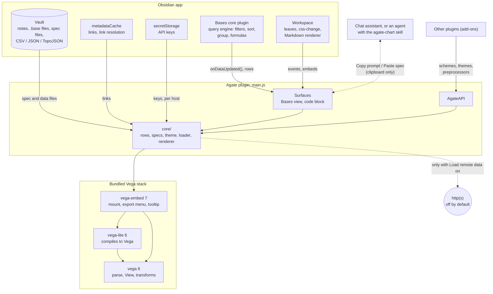

Two boundaries matter. Data only enters through Bases (rows), the vault (files the loader reads) or, when the user turns it on, the network. And Agate holds no API key of its own and makes no call to an AI service: the LLM features move text through the clipboard.

## 3. Code map

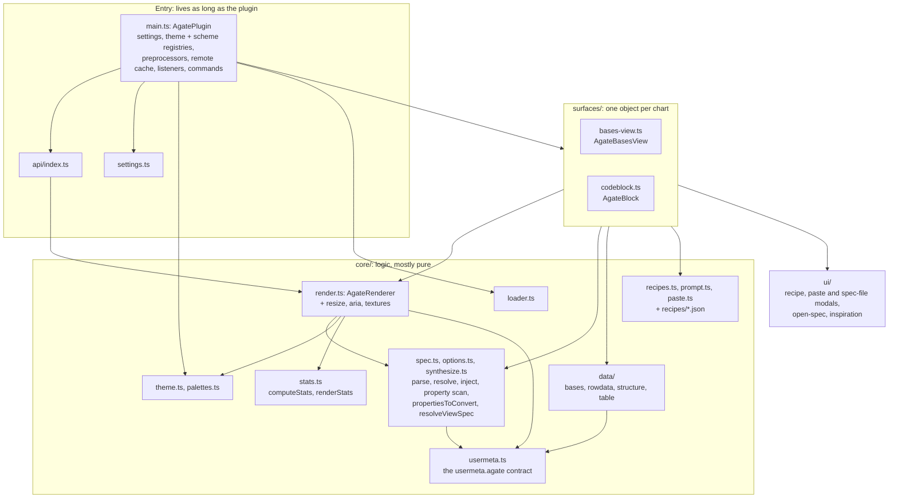

`main.ts` owns all state that outlives a single chart: settings, the theme registry, the data-scheme registry, spec preprocessors, the remote-data cache and the listener sets that tell charts to redraw. Surfaces own a chart's lifecycle. `core/` holds the logic, and most of it is pure functions that the unit tests call directly.

| Area | Files | Lines | Role |
|---|---|---|---|
| Entry | `main.ts`, `settings.ts` | 372, 241 | Plugin object, registries, shared services, commands, settings tab |
| Surfaces | `surfaces/bases-view.ts`, `surfaces/codeblock.ts` | 358, 198 | Obsidian components that own one chart each |
| Rendering | `core/render.ts`, `resize.ts`, `aria.ts`, `textures.ts`, `stats.ts` | 362 + ~345 | vega-embed lifecycle; the extras around it, including the stats HTML output |
| Specs | `core/spec.ts`, `options.ts`, `synthesize.ts`, `usermeta.ts` | 330 + ~120 | Parsing, mode detection, path resolution, data injection, view spec and property selection, the `usermeta.agate` contract |
| Data | `core/data/*` | ~575 | Bases rows and the four derived datasets |
| Look | `core/theme.ts`, `palettes.ts` | 266, 300 | Vega config from Obsidian CSS variables, per-theme palettes |
| Loader | `core/loader.ts` | 195 | Vault reads, schemes, gated remote fetch, secrets |
| Authoring | `core/recipes.ts`, `prompt.ts`, `paste.ts`, `ui/*`, `recipes/*.json` | ~1,100 + specs | Recipes, LLM prompt, paste check, modals |
| API | `api/index.ts` | 102 | Public surface for add-on plugins |

## 4. Startup

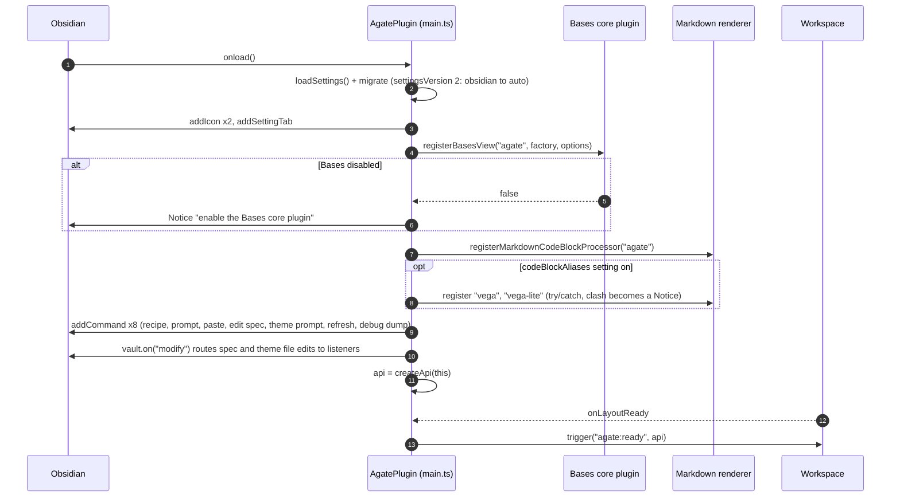

Nothing renders at startup. Charts appear when Bases instantiates an `agate` view or when the Markdown renderer meets an `agate` block. Because aliases are registered once here, toggling the `vega` / `vega-lite` setting needs an app reload.

## 5. Surface A: the Bases view

`AgateBasesView` extends Obsidian's `BasesView`. It appears wherever a base renders: a `.base` tab, an embed (`![[Books.base#Ratings]]`), a ```` ```base ```` block, the sidebar, Canvas. The Bases toolbar is the chart's filter UI.

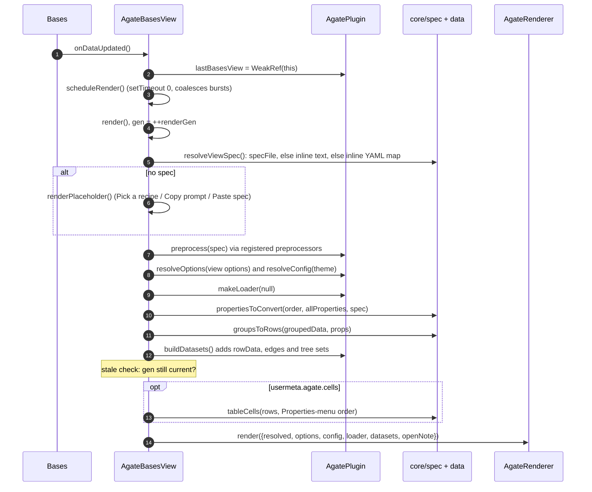

Points worth knowing:

- Two generation counters guard against races. `renderGen` in the view drops results from a slow per-row load that a newer render has overtaken; `generation` in the renderer drops a vega-embed result that finished after a newer embed began.
- View options (spec file, inline spec, dataset name, theme, renderer, interactive, export menu) are declared in the registration and persisted by Obsidian inside the `.base` file. Agate has no per-view storage of its own.
- The placeholder is also the start of every authoring path (section 12).
- The view keeps only Obsidian glue: reading its options, the leaf, modals, the clipboard. Which spec applies and which properties to convert are decided in `core/spec.ts` (ADR-0003 D7), where unit tests cover them.

## 6. Surface B: the code block

An ```` ```agate ```` block holds either a bare Vega/Vega-Lite spec or an envelope (`spec:`, `base:`, `view:`, `data:`, options). `parseBlock` decides which by looking for spec marker keys (`$schema`, `mark`, `marks`, `layer`, …) against envelope keys.

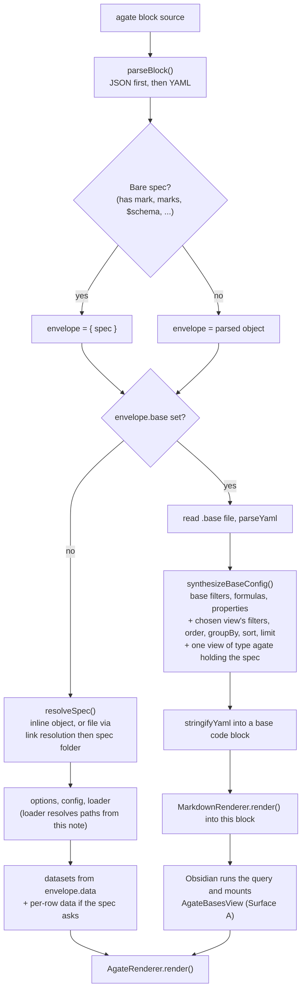

The synthesis trick (D3) is what lets a note chart base data without Agate re-implementing Bases. The spec path is resolved against the note before synthesis, because the synthesized view has no note context. Once a block has delegated to a base, it stops reacting to its own redraw events: the inner Bases view handles data, theme and spec-file changes. See finding R1 in section 15 for the one change that doesn't reach it.

## 7. The renderer

`AgateRenderer` owns one vega-embed result inside one host element. Its main decision is whether a new render can push rows into the existing View or must re-embed.

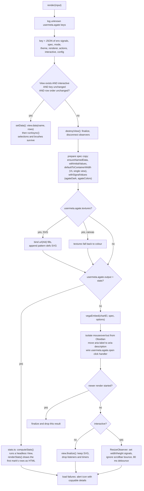

Three Obsidian-specific fixes live here and are easy to break by accident:

| Problem | Fix in `render.ts` / helpers |
|---|---|
| Obsidian's document-level hover handler calls `isShown()` on event targets; Vega marks are `SVGElement`s, so it threw or opened a page preview under the tooltip | Stop `mouseover`/`mouseout` from bubbling out of the chart element (replaced the M0 prototype shim) |
| Obsidian shows a tooltip for every `aria-label`, so a spec `description` popped up on hover | `quietAriaLabels` moves them to `aria-description`, with a MutationObserver for marks added later |
| `width: "container"` only re-measures on window resize, and pane resizes never fire one | `ResizeObserver` sets the container-sized signals directly; `isBounce` ignores the A to B to A scrollbar loop |

A row-order change (Bases sort) forces a re-embed because Vega keeps discrete groups in first-seen order, so `view.data()` alone can't show a new sort. `orderChanged` compares note paths only.

## 8. Data model

### Rows

Each Bases entry becomes one row whose keys mirror Bases property ids, so `"field": "note.rating"` in a spec is the same string the user sees in Bases (D4).

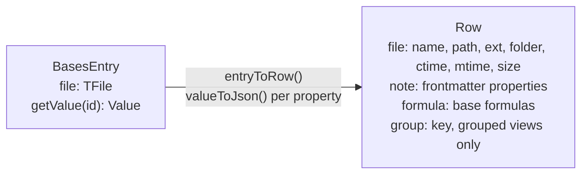

```json
{
  "file": { "name": "Dune", "path": "Library/Dune.md", "ext": "md", "folder": "Library",
            "ctime": "2024-01-02T10:00:00.000Z", "mtime": "…", "size": 4123 },
  "note": { "rating": 5, "published": "1965-08-01", "genre": ["sci-fi"] },
  "formula": { "age": 61 },
  "group": "sci-fi"
}
```

`valueToJson` maps Bases `Value` classes by `instanceof` (constructor names are minified at runtime, so never by name), then peeks at known runtime fields, then falls back to `toString()`:

| Bases Value | JSON |
|---|---|
| `NumberValue`, `BooleanValue`, `StringValue` | number, boolean, string |
| `DateValue` | ISO string (`YYYY-MM-DD` kept as is) |
| `DurationValue` | milliseconds |
| `ListValue` | array, items mapped recursively |
| `LinkValue`, `FileValue` | target path |
| `ObjectValue` | plain object, or parsed `toString()` |
| `NullValue`, missing, errors | `null` or the `toString()` text |

### Which properties get converted

Converting every property of a large base on every update was ruled out (D4), so `propertiesToConvert` (`core/spec.ts`) takes the union of the view's visible properties, `file.name` and `file.path`, and whatever `referencedProperties` finds in the spec: whole strings like `"note.rating"` and lookups inside expressions (`datum.note.x`, `datum["note"]["x"]`, mixed forms). A property the scan misses arrives as `undefined` with no warning. The history and known gaps are in [property-scan.md](property-scan.md).

### Datasets a spec can ask for

A spec declares extra datasets under `usermeta.agate`, which both Vega and Vega-Lite carry through untouched, so the behavior travels with the spec file (D12). Every key is listed once, in `AGATE_KEYS` (`core/usermeta.ts`), and read through `agateMeta()`. Unknown keys are ignored, but **Paste spec** warns about them and the renderer logs them (ADR-0003 D3). The user-facing table is in the guide, section 10.

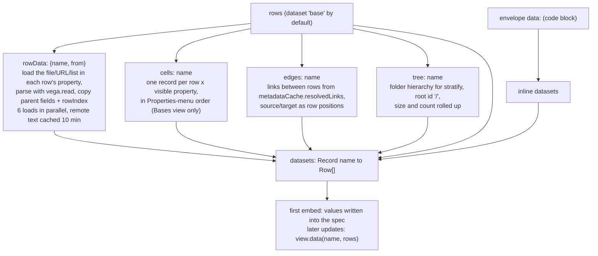

Other `usermeta.agate` keys change behavior rather than data: `open` (click or double-click opens the note behind a mark), `textures` (SVG hatching and dots), `output: "stats"` (big numbers as HTML), `recipe` / `fromRecipe` (section 12).

## 9. Theme and config resolution

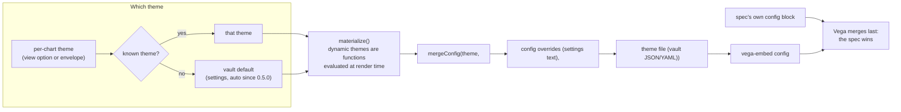

| Theme | Source | Notes |
|---|---|---|
| `auto` (default) | `theme.ts` + `palettes.ts` | `obsidian` fonts and guides, plus a category palette picked for the active community theme (Catppuccin, Nord, Gruvbox, Rosé Pine, Tokyo Night, Minimal schemes, …) or an accent-rotated default |
| `obsidian` | `theme.ts` | Built from Obsidian CSS variables at render time |
| `instrument` | `theme.ts` | Monochrome, monospace "readout" variant of `obsidian` |
| `eink` | `theme.ts` | Tone, outline and shape instead of hue; picked automatically by `auto` for known e-ink themes |
| `dark`, `quartz`, `vox`, … | vega-themes | Static |
| anything else | `api.registerTheme` | Add-on themes |

The theme name comes from `app.customCss.theme` or `vault.getConfig("cssTheme")`, neither of which is public API; both fall back to the default palette. Specs can also read `agateDark` and `agateColors` as signals or params they declare themselves, so a spec still runs unchanged in the Vega editor.

## 10. Loader and the network boundary

Vega fetches through a loader. Agate replaces two of its methods: `load` (data) and `sanitize` (image marks such as map tiles).

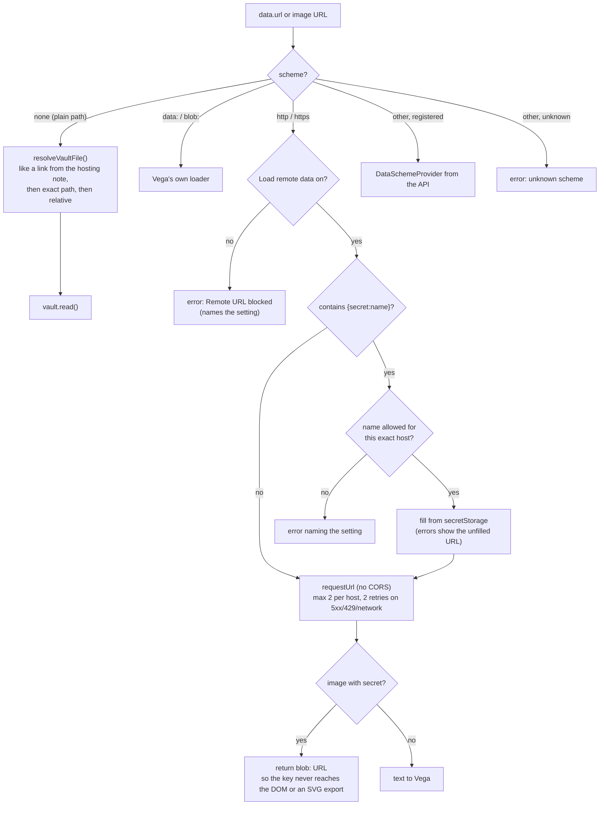

`trackFailures` wraps the loader per render. Vega swallows a failed `data.url` and only logs a warning, so without this a missing file would draw an empty chart silently; with it, the renderer adds an alert icon with a copyable message and keeps whatever did load (a route without its basemap, for example).

One leak is outside the loader's reach and is documented in the README: vega-tooltip renders image URLs in tooltips as ordinary `` elements, which load even with remote data off.

## 11. What makes a chart redraw

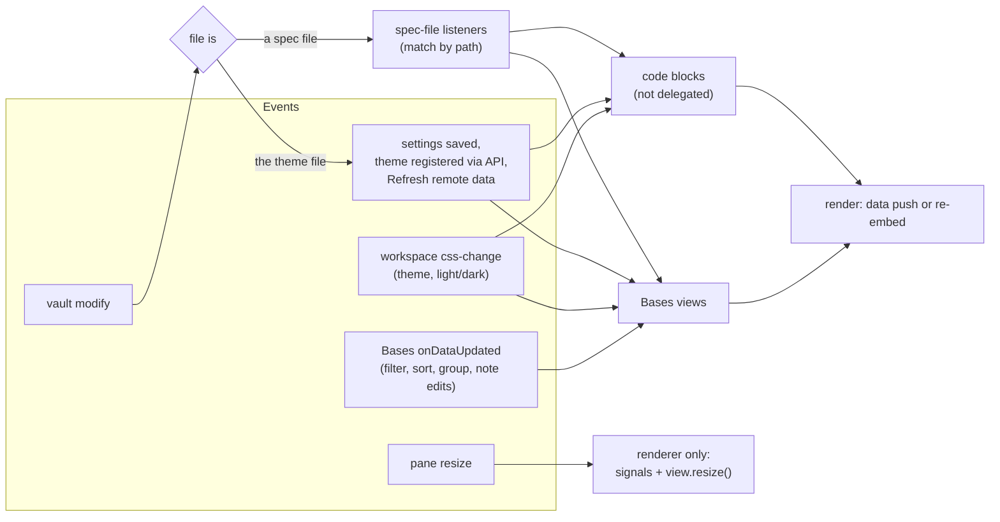

Every chart re-resolves everything on each trigger and lets the renderer decide between a cheap data push and a re-embed. That keeps the surfaces simple; the cost is noted in R3.

## 12. Authoring aids: recipes, prompt, paste, skill

The hard part of a first chart is binding a spec to someone's own property names (D13). Four paths, all ending in a spec file in the spec folder that the view points at:

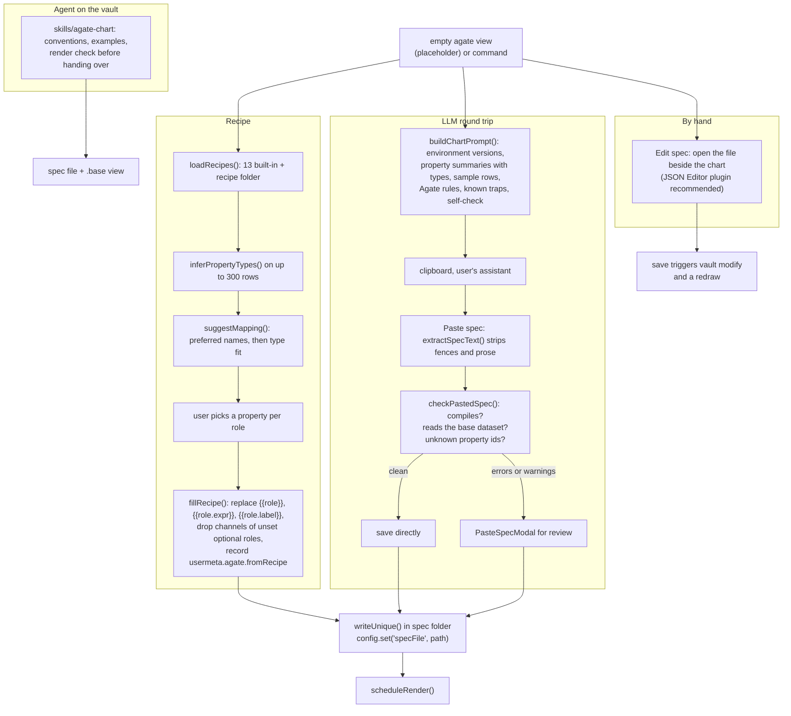

The prompt and the skill state the same conventions (bracket accessors, `"sort": null` for Bases order, no hard-coded colors). `test/unit/skill.test.ts` and `test/unit/prompt.test.ts` keep them from drifting apart.

## 13. Extension API

Reached as `app.plugins.plugins.agate.api`, or on the `agate:ready` workspace event. The one rule (D7): add-ons never bundle Vega. They use `api.vega`, so their registrations land in the instance that renders the charts.

| Method | Effect | Undo |
|---|---|---|
| `registerDataScheme(scheme, provider)` | `scheme://…` URLs go to the provider (text or rows) | returned function; double registration throws |
| `registerExpressionFunction(name, fn)` | Adds to Vega's global expression registry | restores the previous function |
| `registerTheme(name, theme)` | Adds a theme and redraws all charts | restores or deletes |
| `registerSpecPreprocessor(fn)` | Rewrites specs before render, in registration order; a throwing preprocessor is skipped with a warning | removes it |
| `render(el, spec, options)` | Full pipeline into an element the add-on owns | `destroy()` on the handle |
| `vega`, `vegaLite`, `vegaVersion`, `apiVersion: 1` | Escape hatches | |

## 14. Build, test, release

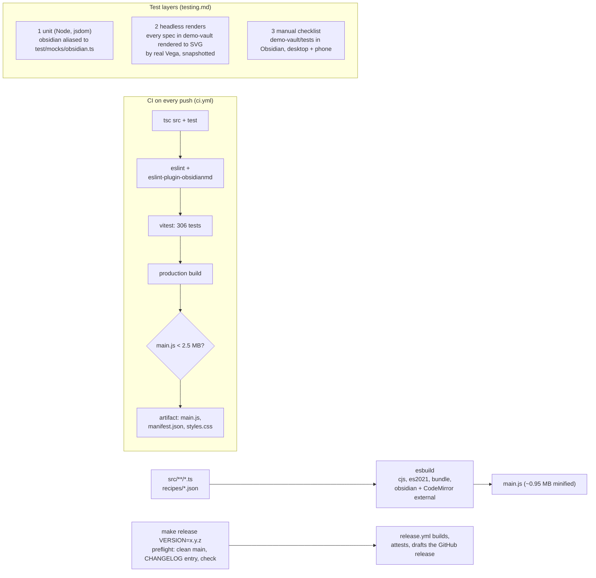

`core/` is testable because `vitest.config.mts` aliases `obsidian` to a mock that implements just what `core/` touches: YAML, `normalizePath`, `TFile`, an in-memory vault with link resolution, `requestUrl`, and the Bases `Value` classes. That mock is the import rule for `core/` (ADR-0003 D1): what it implements, `core/` may use at runtime. `render.ts` is the exception (it uses `setIcon` and Obsidian's DOM helpers) and, with surfaces, `main.ts` and `settings.ts`, is left to layer 3. `renderStats` uses plain DOM calls so it runs under jsdom. The rule in `testing.md` holds: put decisions in `core/` and keep surfaces thin.

## 15. Review

### What holds up

- **One query engine, one renderer.** Agate has no filter, sort or formula code to keep in step with Bases, and every surface shares the same bugs and fixes. The synthesized ```` ```base ```` block, the riskiest idea in ADR-0001, worked in M0 and still carries the code-block path.
- **Specs stay portable.** Everything Agate-specific sits under `usermeta.agate` or in signals the spec declares itself with its own defaults, so a spec still runs in the Vega editor once the `base` dataset gets inline values.
- **Data push versus re-embed** is the right split. Brushes and selections survive toolbar changes, and the order-change exception is precise rather than a blanket re-embed.
- **Network posture is conservative and explained.** Off by default, per-host secret allowlist, keys kept out of error messages and the DOM, failures shown instead of swallowed.
- **Lifecycle discipline.** Each chart lives in an Obsidian component, finalizes its View and disconnects three observers on unload, and has a debug-only live-View counter for leaks.
- **Comments explain why.** Almost every non-obvious line (the hover isolation, the bounce check, why JSON is parsed before YAML) says what broke without it.

### Risks and findings

Ordered by how likely they are to bite a user.

| # | Finding | Where | Effect | Suggestion |
|---|---|---|---|---|
| R1 | A code block with `base:` copies the `.base` file's YAML at render time. Edits to that base's filters, formulas or the named view do not reach the block until the note re-renders. Spec-file edits do reach it (the inner view watches `specFile`). Read from the code; confirm in Obsidian. | `codeblock.ts` `renderThroughBase`, `delegatedToBase` | Stale chart after editing the base | Subscribe the block to `vault.on("modify")` for its `.base` path and re-run synthesis |
| R2 | Silent empty charts remain possible: a property the scan misses (field strings with spaces, names built at runtime) converts to `undefined` with no warning. | `spec.ts` `PROP_STRING`, `PROP_IN_EXPR` | Blank chart, no error box | Allow spaces in `PROP_STRING`; in debug mode log spec-referenced `note.*` ids absent from `allProperties`; switch to Vega's `parseExpression` if another regex gap appears (all in property-scan.md) |
| R3 | *Partly fixed: code blocks now batch like Bases views; the broadcast on every settings save remains.* Any settings save, theme registration or `css-change` re-resolves config and re-runs every open chart, including toggling Debug logging. Code blocks don't coalesce bursts the way Bases views do. Correct (generation counters drop stale work) but repeated work. | `main.ts` `emitSettingsChanged`, `codeblock.ts` `onload` | Jank in vaults with many open charts | Coalesce in `AgateBlock` like `scheduleRender`; skip the broadcast for settings that don't affect rendering |
| R4 | *Fixed: commands use `targetBasesView()`.* Commands act on `lastBasesView`, the view whose data last updated, not the focused one. With two charts visible, "Edit the spec of the last chart" can open the other chart's spec. | `main.ts` commands, `bases-view.ts` `onDataUpdated` | Confusing target | Prefer the view in the active leaf; fall back to the last updated |
| R5 | Static charts (`interactive: false`) re-embed on every data update, because a finalized View can't take new data. | `render.ts` reuse condition | Slower toolbar changes on big static charts | Fine as designed; document it next to the option |
| R6 | Undocumented Obsidian internals: theme name (`customCss.theme`, `getConfig("cssTheme")`), `viewRegistry`, `plugins.enabledPlugins`, `get/setConfig("showUnsupportedFiles")`. Each has a fallback. | `main.ts`, `ui/open-spec.ts` | `auto` loses per-theme palettes if they move | Keep the fallbacks; add one unit test per fallback path |
| R7 | *Fixed: revoked in `destroyView`.* Blob URLs for keyed image tiles are never revoked. | `loader.ts` `sanitize` | Memory growth only with keyed basemaps redrawn many times | Track per render; revoke in `destroyView` |
| R8 | The embed key is `JSON.stringify` of spec and config on every render. | `render.ts` | Negligible unless a spec inlines large `values` | Leave it; revisit only if profiling says so |

### Resolved by ADR-0003

The first pass of this review found six places where the code had moved past ADR-0001, and suggested three structural changes. [ADR-0003](adr/0003-state-at-0-5.md) records all of them:

| ADR-0003 | What changed |
|---|---|
| D1 | `core/` may use at runtime what `test/mocks/obsidian.ts` implements (was: types and pure helpers only). Types live in `core/types.ts` |
| D2 | Container sizing applies to single-view Vega-Lite only; Vega specs size themselves |
| D3 | One `usermeta.agate` contract: `core/usermeta.ts`, the guide's reference table, a warning for unknown keys, a test that keeps the code and the table in step |
| D4 | Extension API is the smaller set plus `api.vega`; the four extra register wrappers wait for an add-on that needs them |
| D5, D6 | Default theme `auto`; thirteen recipes |
| D7 | `renderStats` moved to `stats.ts`; `propertiesToConvert` and `resolveViewSpec` moved from the Bases view to `core/spec.ts`, with tests |

### Next candidates

Ordered by value for effort. All four are done.

1. **Done: one place builds datasets.** `edges` and `tree` are now built by `structureDatasets` (`core/data/structure.ts`), which `plugin.buildDatasets` calls for both surfaces, so code blocks with inline `data:` rows get them too. `cells` stays in the Bases view, because it needs the Properties-menu order.
2. **Done: coalesce code-block renders (R3).** `AgateBlock.scheduleRun` batches redraw triggers per tick, as the Bases view's `scheduleRender` does.
3. **Done: revoke tile blob URLs (R7).** `trackBlobs` (`core/loader.ts`) collects them per embed, and `destroyView` revokes them, as does a stale embed when it is dropped.
4. **Done: commands target the focused chart (R4).** `plugin.targetBasesView()` picks an Agate view in the most recent leaf, and falls back to `lastBasesView`.

## 16. File index

| File | Read it for |
|---|---|
| `src/main.ts` | Plugin state, commands, `resolveConfig`, `makeLoader`, `buildDatasets`, `loadRecipes` |
| `src/surfaces/bases-view.ts` | Surface A, view options, property selection, recipe/prompt/paste entry points |
| `src/surfaces/codeblock.ts` | Surface B and base synthesis |
| `src/core/render.ts` | Embed versus update, resize, hover and aria fixes, load failures |
| `src/core/stats.ts` | Big numbers: headless run (`computeStats`) and HTML output (`renderStats`) |
| `src/core/spec.ts` | Block parsing, mode detection, path resolution, data injection, property scan, view spec resolution |
| `src/core/usermeta.ts` | The `usermeta.agate` contract: every key, one accessor, unknown-key check |
| `src/core/data/bases.ts` | `Value` to JSON and row assembly |
| `src/core/data/rowdata.ts`, `structure.ts`, `table.ts` | The `rowData`, `edges`, `tree`, `cells` datasets |
| `src/core/theme.ts`, `palettes.ts` | Dynamic themes and per-theme palettes |
| `src/core/loader.ts` | Vault loader, network gate, secrets, per-host limits |
| `src/core/recipes.ts`, `prompt.ts`, `paste.ts` | Authoring aids |
| `src/api/index.ts` | Add-on API |
| `test/mocks/obsidian.ts` | What "pure" means for `core/` in practice |
| `docs/adr/0001-architecture-and-roadmap.md` | Why it is built this way |
| `docs/adr/0003-state-at-0-5.md` | What changed since ADR-0001 |
