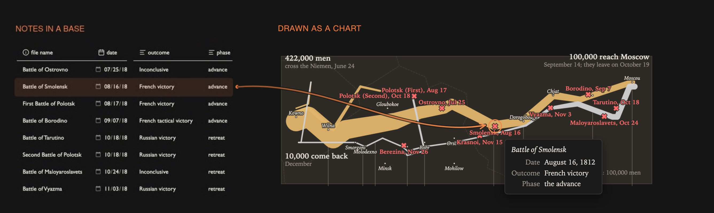
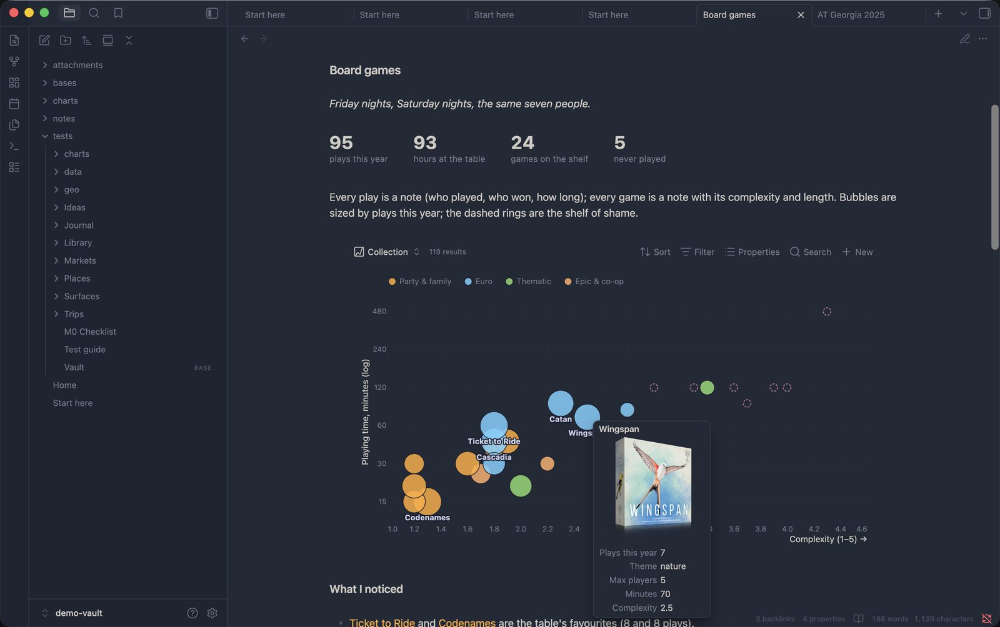
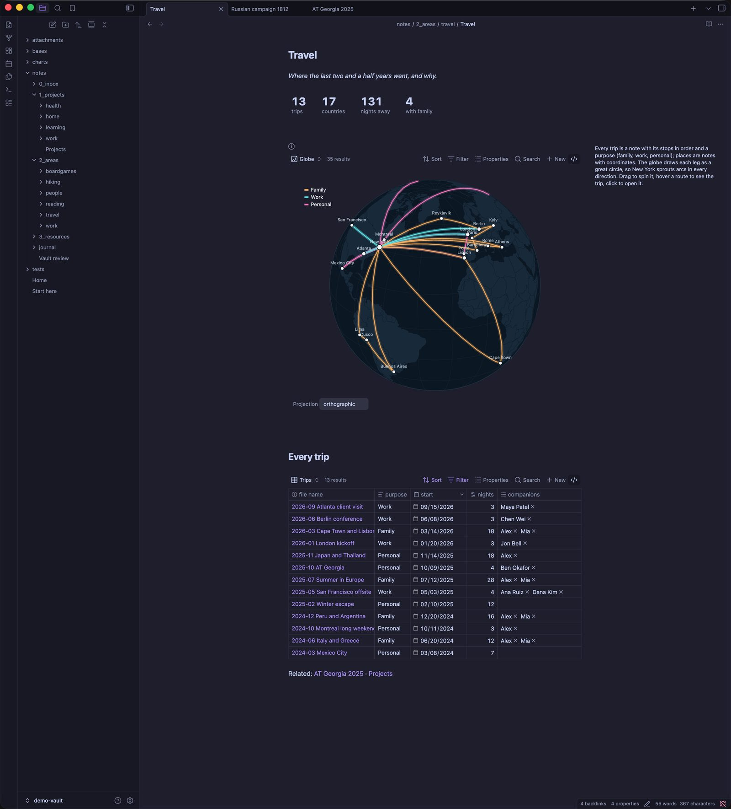
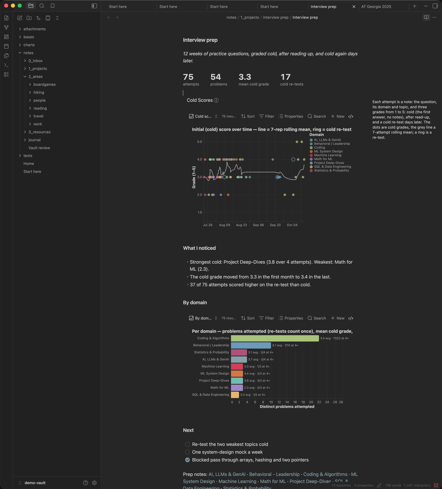
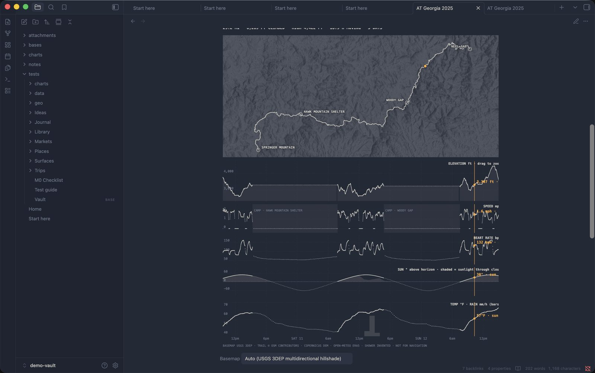

# [Plugin] Agate: turn your Bases into Vega charts

Hi all! A little story first.

I wanted a few dashboards in my vault: where I went on my vacation in the Azores, how I'm doing at work, that sort of thing. So I went looking for chart plugins. The ones I found were limited, and they came with built-in style choices I mostly didn't like.

I knew what I wanted: the freedom to build anything from a wide range of chart types, with my own design choices, all connected to the live data in Bases. In other words, I wanted Vega.

There is a Vega plugin already, [Vega Visualizations](https://community.obsidian.md/plugins/obsidian-vega) by Justin-J-K. Thank you so much for building it! But its charts are static, with the data written into the spec, so they can't read from Bases. That left only a small gap to cross, and lo and behold: **Agate**.

Add an **Agate chart** view to any base, and your notes become bars, timelines, maps, networks, or something stranger.

*That's Minard's famous map of Napoleon's 1812 campaign. Each battle is an ordinary note with a date, a place and the size of the army, and Agate drew the map from a base of those notes.*

A few things you should know up front:

- **Agate is vibe-coded.** It was built with heavy help from AI coding agents.
- **I use it myself, every day.** My own vault depends on it, so I plan to keep maintaining it for the foreseeable future.
- **It's a bit opinionated.** The premise is simple, though: proper Vega and Vega-Lite charts, fed by Obsidian Bases.

**Install:** Settings → Community plugins → Browse → *Agate*. Needs Obsidian 1.13+ with the core Bases plugin on. Works on desktop and mobile.
**Links:** [Website](https://casyfill.github.io/Agate/) · [15-minute quickstart](https://casyfill.github.io/Agate/quickstart.html) · [Gallery](https://casyfill.github.io/Agate/gallery.html) · [GitHub](https://github.com/Casyfill/Agate)

---

## Why Vega

I've used Vega and Vega-Lite for years, and I still think they're among the best ways to make a chart. What I love about Vega is that it doesn't give you a fixed list of chart types. It's a **grammar**: you describe what the data is, which marks to draw, and how fields map to position, color and size. That gets you a lot:

- **It's mature.** Vega came out of the University of Washington's Interactive Data Lab more than a decade ago, and the same specs run in Altair, Jupyter, Observable, Power BI and Kibana. There are hundreds of examples to borrow from.
- **Data, style and chart stay separate.** The base decides which notes go in. The theme decides how it looks; by default Agate's follows your Obsidian theme and dark mode. The spec only describes the picture. Point a chart at a different base and it draws your trips instead of your books. Swap the mark and a bar chart becomes a heatmap.
- **It goes far.** Maps and spinnable globes, force-directed networks, sunbursts, sankeys, linked dashboards where brushing one panel filters the others. If Vega can draw it, Agate can draw it from your notes.
- **LLMs know it well.** After a decade of public specs, any chat assistant writes decent Vega-Lite, so you don't have to learn the grammar to get a chart.

## What you could chart

If your notes have properties, you already have a dataset. Some ideas:

- **Collections.** Board games, books, records, plants. Which games actually get played, how long a "quick game" really takes, and who keeps winning.

  

- **Travel.** Give place notes coordinates and link them from trip notes. Your year of trips becomes routes on a globe you can drag around.

  

- **Job interviews.** One note per practice question, graded when you first answer it, again after reading up, and once more days later. You can see which topics are getting better and which ones you keep avoiding. One note per application, with a stage and a date, gives you a pipeline from applied to offer.

  

- **Exercise and the outdoors.** Workouts, runs, hikes. A multi-day hike can be drawn over real terrain tiles, with camps and summits marked.

  

- **Habits and mood.** A daily note with a few numbers adds up to a year of streaks and slumps.
- **Your vault itself.** How your notes link to each other, and which folders take up all the space.

Click any point, bar or node, and Agate opens the note behind it.

## How a chart gets made

1. Open a base, add a view, and choose **Agate chart** as its layout.
2. Then do one of these:
   - **Pick a recipe.** There are 13 ready-made charts: timeline, bars, scatter, calendar heatmap, link graph, travel globe, sankey and more. Agate asks which property goes where, and you're done.
   - **Ask an AI.** **Copy prompt for an LLM** copies your base's properties and a few sample rows. Paste that into any assistant and describe the chart you want, then copy its reply and press **Paste spec**. Agate checks the reply and saves it.
   - **Write it yourself.** Grab an example from the [Vega-Lite gallery](https://vega.github.io/vega-lite/examples/), set its data to `{"name": "base"}`, and rename the fields to your properties (`note.rating`, `file.name`, `formula.age`).
3. Use the normal Bases toolbar to filter, sort and group, and the chart follows. Embed it in any note with `![[Books.base#Ratings]]`, or drop it on a Canvas.

The spec is a plain JSON file next to your notes. It syncs, diffs and versions like any other file, and it still works in the Vega editor if you ever leave Agate.

## A few bonuses

These are extras I wanted for my own vault:

- **Big numbers.** One line in a spec turns it into headline numbers (books read this year, average rating, ▲ 12% from last year), shown as note text instead of a chart. They follow the base's filters like any chart. This turned out to be the feature I use most. *(Still experimental.)*

  

- **More data than your properties.** A note can point to its own CSV, JSON file or URL, for example a price history for each stock note or a weather series for each city note. Agate also exposes the links between your notes and your folder tree as datasets, which is what the network graphs and sunbursts are drawn from.
- **Basemaps and images.** Put real map tiles (Esri, USGS, OpenTopoMap, or keyed providers like MapTiler) under your routes and points. API keys stay in Obsidian's secret storage and are sent only to the host you allow. Image marks and tooltips can show book covers, photos, anything with a URL.

And a promise: **Agate makes no network requests by default.** Remote data, map tiles and images load only after you turn on *Load remote data*.

---

I'd love to see what you chart with it, and to hear what's confusing or broken. Reply here or open a [GitHub issue](https://github.com/Casyfill/Agate/issues). Thanks for reading!
